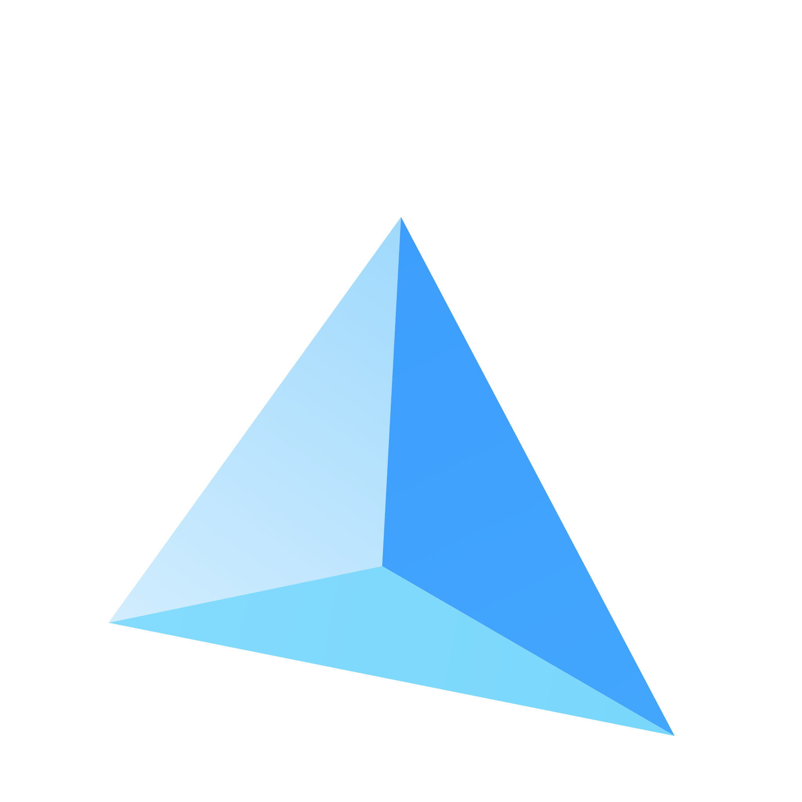
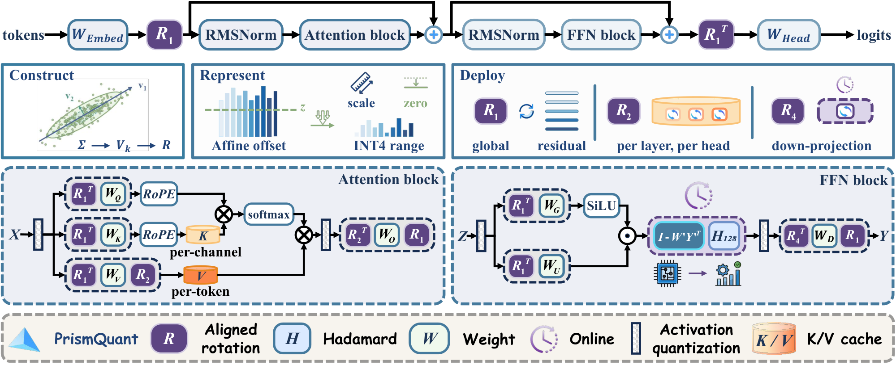
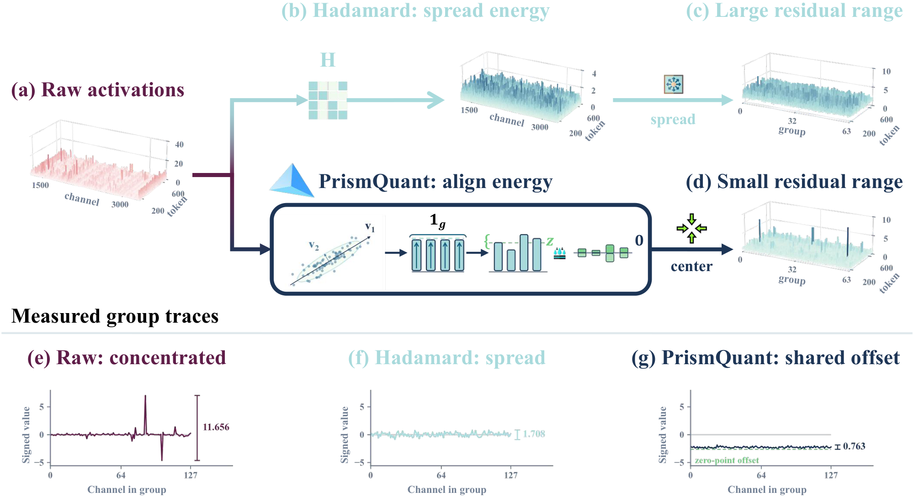
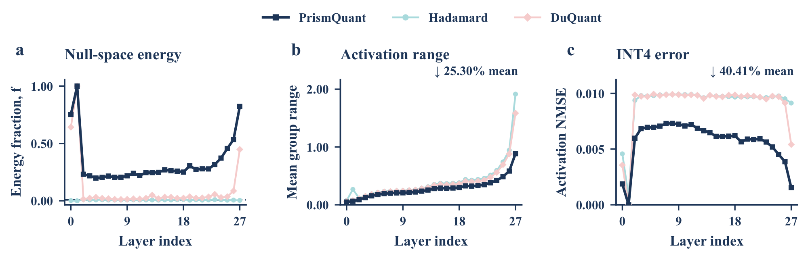
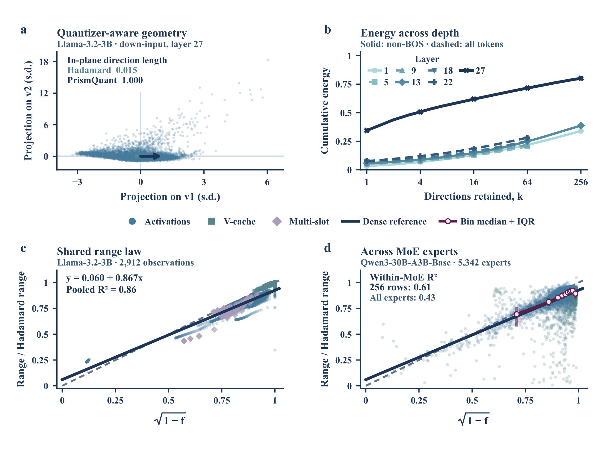

<div align="center">



# PrismQuant

**Optimal Null-Space Rotations for Grouped Quantizers**

[Paper](https://arxiv.org/abs/2609.32429) · [Hugging Face](https://huggingface.co/ForeverBlue/PrismQuant-Qwen3-Base) · [Models](docs/models.md) · [Indexed results](https://paperswithcode.co/paper/2609.32429#results) · [Quick start](#quick-start) · [Method](#method) · [Figures](Figures/README.md) · [Reproduction](docs/reproduction.md)

[](https://arxiv.org/abs/2609.32429)

</div>

Official code and pretrained checkpoints for
**[PrismQuant: Optimal Null-Space Rotations for Grouped Quantizers](https://arxiv.org/abs/2609.32429)**
(arXiv:2609.32429), by Yanlong Chen, Yining Chen, Song Zhang, Amirhossein Habibian,
and Yawei Li. See the [released models](#released-models) for all Hugging Face checkpoints.



PrismQuant aligns high-energy activation directions with the constant directions
of quantization groups. It combines calibrated orthogonal rotations, compact-WY
representations and groupwise asymmetric INT4 quantization. This repository
contains the core implementation, released model checkpoints and paper figures.

## Quick start

Use Python 3.10+ and a PyTorch installation appropriate for your CUDA version.

```bash
git clone --depth 1 https://github.com/ForeverBlue816/PrismQuant.git
cd PrismQuant
pip install -e .
prismquant models
```

Start with the smallest released model:

```python
from prismquant import load_model

model = load_model("qwen3_0.6b_base")
print(model.generate("The key idea behind quantization is", max_new_tokens=64))
```

Or use the command line:

```bash
prismquant generate --model qwen3_0.6b_base \
  --prompt "The key idea behind quantization is" --max-new-tokens 64
```

The loader downloads only the selected checkpoint and its required rotation
factors, then obtains the matching base model and tokenizer. The default
PrismQuant configuration is selected automatically. These are **base-model completions**, not chat-tuned
assistants. See [model selection, memory and loading options](docs/models.md).

**Checkpoint format.** The released GPTQ weights are dequantized INT4 values in
floating-point tensors. The reference runtime simulates activation and KV
quantization while retaining floating-point storage; it is not a packed INT4
serving engine. Use this package's loader, rather than passing the artifact repo
to `AutoModelForCausalLM.from_pretrained`. The separate fused R4 kernels are
provided for implementation work.

## Released models

| Family | Sizes | Hugging Face |
| --- | --- | --- |
| Qwen3 Base | 0.6B, 1.7B, 4B, 8B | [Checkpoints and rotation factors](https://huggingface.co/ForeverBlue/PrismQuant-Qwen3-Base) |
| Qwen3 MoE Base | 30B-A3B | [Checkpoint and expert rotations](https://huggingface.co/ForeverBlue/PrismQuant-Qwen3-30B-A3B-Base) |
| Llama 3.2 | 3B | [Checkpoints and rotation factors](https://huggingface.co/ForeverBlue/PrismQuant-Llama-3.2-3B) |
| Llama 3.1 | 8B | [Checkpoints and rotation factors](https://huggingface.co/ForeverBlue/PrismQuant-Llama-3.1-8B) |
| Llama 3.1 | 70B | [Checkpoints and rotation factors](https://huggingface.co/ForeverBlue/PrismQuant-Llama-3.1-70B) |

The [model catalog](prismquant/models.json) pins the model artifacts and base
models to exact revisions. The MoE release includes all expert weights and
per-expert rotations. Upstream model licenses apply.

## Method

1. **Construct:** estimate dominant uncentered activation directions and map them
   to group anchors with Householder reflectors and a balanced permutation.
2. **Represent:** apply block Hadamard transforms so aligned directions become
   constant within groups; store the group scale and real affine offset in fp16.
3. **Deploy:** fold static transforms into weights and use compact-WY factors for
   the remaining online rotations.



The core rotation can also be used independently of a language model:

```python
import torch
from prismquant import fit_rotation, dynamic_asym_int4

calibration = torch.randn(512, 256)  # replace with your calibration activations
rotation = fit_rotation(calibration, rank=2, group_size=128)
signs = torch.ones(256)
rotated = rotation.apply(calibration, signs)
quantized, scale, offset, codes = dynamic_asym_int4(rotated, 128)
reconstructed = rotation.transpose(quantized, signs)
```

This example fits a rotation from user-provided activation samples using exact
second moments. See [the technical guide](docs/method.md) for conventions and
[the kernel guide](docs/kernels.md) for the fused path.

## Results and figures

[](https://paperswithcode.co/benchmark/wikitext-2?task=language-modeling&eval=33009)

Seven paper results are indexed on [Papers with Code](https://paperswithcode.co/paper/2609.32429#results).
As checked on **2026-10-14**, PrismQuant on **Llama-3.1-70B, W4A4KV4, k=8**
has **3.85 WikiText-2 perplexity** and ranks first among that site's indexed
WikiText-2 results. This rank is specific to the indexed comparison set;
base models, tokenizers, precision budgets and evaluation protocols differ.
The badge shows the published score, not a live rank.

All seven scores are unchanged, and the catalog now includes the checkpoint
links and clarified evaluation protocols. See [verified evaluation metadata](docs/evaluation_metadata.md)
for evaluation settings and reproduction guidance. Catalog verification is
not an independent experimental replication.





The [figure gallery](Figures/README.md) includes the author's final Figure 1–6,
method overview and activation matrices, with PDF originals and PNG/SVG previews.
Figure 5 reports the dedicated deployment implementation; its throughput should
not be attributed to the floating-point reference loader above.

## Repository layout

```text
prismquant/       Rotation, quantization, GPTQ, folding, loading and CUDA kernels
examples/         Text completion and standalone rotation examples
Figures/          Author-provided paper figures and shareable previews
docs/             Model format, technical guide and reproduction pointers
tests/            Algebra, metadata, loading and generation checks
```

This repository provides the reference implementation, released model catalog,
tests and paper figures. See [reproduction guidance](docs/reproduction.md) for
model revisions, evaluation settings and the scope of the public package.

## Development

```bash
pip install -e '.[dev]'
pytest -q
```

See [release validation](docs/validation.md) for the test scope and numerical checks.

## Paper and citation

**[PrismQuant: Optimal Null-Space Rotations for Grouped Quantizers](https://arxiv.org/abs/2609.32429)**

Yanlong Chen, Yining Chen, Song Zhang, Amirhossein Habibian, and Yawei Li.

```bibtex
@article{chen2026prismquant,
  title={PrismQuant: Optimal Null-Space Rotations for Grouped Quantizers},
  author={Chen, Yanlong and Chen, Yining and Zhang, Song and Habibian, Amirhossein and Li, Yawei},
  journal={arXiv preprint arXiv:2609.32429},
  year={2026},
  doi={10.48550/arXiv.2609.32429},
  url={https://arxiv.org/abs/2609.32429}
}
```

## License and acknowledgments

Code: [Apache-2.0](LICENSE). Model weights retain their respective upstream
licenses. Built with Llama for the Llama-derived checkpoints. The GPTQ core is
adapted from [QuaRot](https://github.com/spcl/QuaRot); see
[third-party notices](THIRD_PARTY_NOTICES.md).
